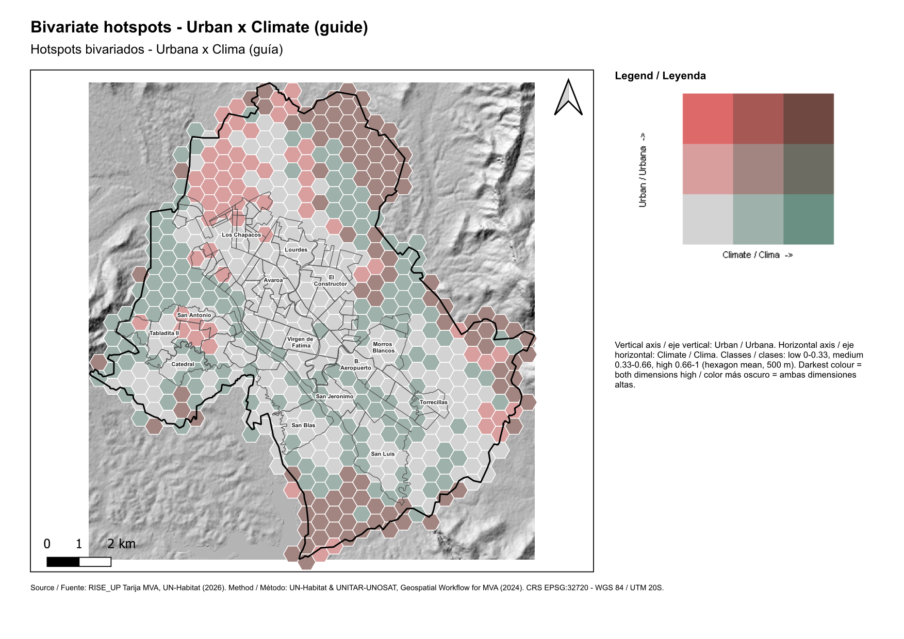

# MVA Tarija - Multilayered Vulnerability Assessment (Tarija, Bolivia)

**English** · [Español](#español)

Reproducible application of the UN-Habitat / UNITAR-UNOSAT *Geospatial Workflow for Multilayered Vulnerability Assessment (MVA)* (RISE UP, November 2024) to the urban area of **Tarija, Bolivia**. The workflow combines three dimensions (Climate Change (CC), Biodiversity (BIO) and Urban (URB)) into:

- 11 indicators normalized 0-1 (1 = highest vulnerability), on a 12.5 m grid in EPSG:32720;
- three dimension vulnerabilities;
- a combined vulnerability;
- hotspot maps on 500 m hexagons, including three bivariate maps.

> The guide itself is (c) UNITAR-UNOSAT under CC BY-NC-ND. This repository follows its structure and cites it; it does not reproduce its text or figures.

## Start here
| | English | Español |
|---|---|---|
| Overview and deviations from the guide | [00_overview](docs/en/00_overview.md) | [00_resumen](docs/es/00_resumen.md) |
| Phase 0 - mapping of existing layers | [01](docs/en/tarija/01_phase0_mapping.md) | [01](docs/es/tarija/01_fase0_mapeo.md) |
| Phase 1 - indicators | [02](docs/en/tarija/02_phase1_indicators.md) | [02](docs/es/tarija/02_fase1_indicadores.md) |
| Phase 2 - vulnerability | [03](docs/en/tarija/03_phase2_vulnerability.md) | [03](docs/es/tarija/03_fase2_vulnerabilidad.md) |
| Phase 3 - hotspots, layouts and legends | [04](docs/en/tarija/04_phase3_hotspots.md) | [04](docs/es/tarija/04_fase3_hotspots.md) |
| **Map gallery (24 maps)** | [05](docs/en/tarija/05_map_gallery.md) | [05](docs/es/tarija/05_galeria_mapas.md) |

## Key results (500 m hexagons, guide classes)
| Dimension | Low | Medium | High | Mean |
|---|---|---|---|---|
| Climate | 282 | 268 | 0 | 0.34 |
| Urban | 385 | 165 | 0 | 0.29 |
| Biodiversity | 16 | 239 | 294 | 0.64 |
| Combined | 10 | 540 | 0 | 0.42 |

103 hexagons are medium in both Urban and Climate vulnerability (bivariate hotspots under the guide classes), on the northern, eastern and southern periphery. Complementary standard-deviation and quintile classes show relative hotspots within Tarija ([04](docs/en/tarija/04_phase3_hotspots.md)).

## Repository layout
| Folder | Content |
|---|---|
| `docs/en`, `docs/es` | Method, decisions and deviations from the guide, step by step |
| `docs/img/tarija` | 24 maps (PNG, 150 dpi) and the 3x3 bivariate legends |
| `config/tarija.yaml` | CRS, grid and indicator list |
| `scripts/tarija` | PyQGIS scripts, one per step (run in order 1, 2, 3, 3b, 3c) |
| `styles/tarija` | QGIS styles (.qml) with bilingual legends |
| `metadata/tarija` | QGIS metadata (.qmd, EN/ES) of the final products |

Data (rasters, GeoPackages) are **not** included because of their licences and size; they are listed in the project data inventory.

## Requirements and use
QGIS 3.44 or newer (PyQGIS, GDAL and NumPy included). Edit the folder lines marked `# <- edit` at the top of each script, then run it from the QGIS Python console (see [scripts/README](scripts/README.md)).

## Licence and citation
- Code (`scripts/`, `config/`): [MIT](LICENSE).
- Documentation, maps, styles and metadata: [CC BY 4.0](LICENSE-docs.md).
- How to cite: [CITATION.cff](CITATION.cff).

Maps show results of a technical vulnerability assessment; they are not official boundaries or hazard maps.

---

## Español

Aplicación reproducible de la guía de UN-Habitat / UNITAR-UNOSAT *Geospatial Workflow for Multilayered Vulnerability Assessment (MVA)* (RISE UP, noviembre de 2024) en el área urbana de **Tarija, Bolivia**. El flujo combina tres dimensiones (Cambio Climático (CC), Biodiversidad (BIO) y Urbana (URB)) en:

- 11 indicadores normalizados de 0 a 1 (1 = mayor vulnerabilidad), en una grilla de 12.5 m en EPSG:32720;
- tres vulnerabilidades por dimensión;
- una vulnerabilidad combinada;
- mapas de hotspots en hexágonos de 500 m, incluidos tres mapas bivariados.

> La guía es (c) UNITAR-UNOSAT bajo licencia CC BY-NC-ND. Este repositorio sigue su estructura y la cita; no reproduce su texto ni sus figuras.

**Por dónde empezar:** ver la tabla *Start here* de arriba (columna Español), en especial la [galería de mapas](docs/es/tarija/05_galeria_mapas.md).

**Resultados principales:** en hexágonos de 500 m y con las clases de la guía, 103 hexágonos tienen vulnerabilidad media a la vez en lo urbano y lo climático (hotspots bivariados), en la periferia norte, este y sur. La biodiversidad es la dimensión más alta (media 0.64). Las clases complementarias por desviación estándar y por quintiles muestran hotspots relativos dentro de Tarija ([04](docs/es/tarija/04_fase3_hotspots.md)).

**Estructura:**

- `docs/en` y `docs/es`: método, decisiones y desviaciones, paso a paso.
- `docs/img/tarija`: 24 mapas PNG y leyendas bivariadas.
- `config/tarija.yaml`: SRC, grilla e indicadores.
- `scripts/tarija`: scripts PyQGIS por paso (ejecutar en orden 1, 2, 3, 3b, 3c).
- `styles/tarija`: estilos QGIS .qml.
- `metadata/tarija`: metadatos .qmd EN/ES.

Los datos (rásters, GeoPackages) **no** se incluyen por sus licencias y su tamaño; están listados en el inventario de datos del proyecto.

**Requisitos y uso:** QGIS 3.44 o superior. Edite las líneas de carpeta marcadas con `# <- edit` al inicio de cada script y ejecútelo desde la consola Python de QGIS (ver [scripts/README](scripts/README.md)).

**Licencia y cita:**

- Código: [MIT](LICENSE).
- Documentación, mapas, estilos y metadatos: [CC BY 4.0](LICENSE-docs.md).
- Cómo citar: [CITATION.cff](CITATION.cff).

Los mapas muestran resultados de una evaluación técnica de vulnerabilidad; no son límites ni mapas de amenaza oficiales.
